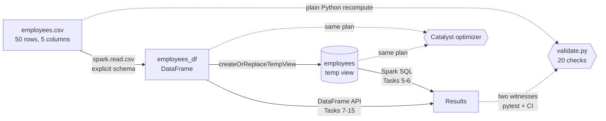

# ⚡ Employee Data Analysis with PySpark & Spark SQL

[](https://github.com/SaBuMa/pyspark-employee-analytics/actions/workflows/ci.yml)


An employee dataset analyzed with **PySpark DataFrames** and **Spark SQL**: loading with an explicit schema, filtering, aggregations, a self-join, sorting and string matching. Every answer is **cross-checked by a second method** and **independently verified** in plain Python, with automated tests in CI.

> Final project of the **IBM "Introduction to Big Data with Spark and Hadoop"** course (Coursera, IBM Data Engineering Professional Certificate), extended with reusable code, a validation layer, 28 tests and GitHub Actions CI.

---

## 📌 Highlights

- **15 tasks** with the DataFrame API and Spark SQL: explicit schema, temp view, `groupBy`/`agg`, `withColumn`, self-join, multi-key sort, pattern filters
- **Two independent witnesses**: PySpark results are checked against a plain-Python recomputation (**20/20 checks**), and the aggregates are reconciled against each other (Σ counts = 50, Σ department totals = company total of 309,116)
- **28 tests** (8 plain Python + 20 PySpark) run on every push by **GitHub Actions** with Java 17
- **Real bugs found and locked in by tests**: a schema that silently swapped `Salary` and `Age`, a `show()` saved as `None`, floating-point bonus values, non-deterministic ordering on ties
- **Documented Spark concepts**: lazy evaluation, immutability, views, Catalyst, shuffles, joins, floating point, case sensitivity

---

## 🏗️ Architecture



---

## 🧰 Tech Stack

| Layer | Tools |
|---|---|
| Processing | Apache Spark (PySpark 4.0): DataFrame API, Spark SQL |
| Language | Python 3.12 |
| Runtime | Java 17 (JVM) |
| Validation & testing | Python standard library · pytest |
| CI | GitHub Actions |
| Environment | IBM Skills Network JupyterLab (course) · local Spark (`local[*]`) |

---

## 📂 Repository Structure

```
pyspark-employee-analytics/
├── .github/workflows/
│   └── ci.yml                          # Java 17 + Python: validate, test, run
├── data/
│   └── employees.csv                   # 50 employees (course dataset)
├── notebooks/
│   └── employee_analysis.ipynb         # All 15 tasks with cross-checks
├── src/
│   └── employee_analysis.py            # One function per task (used by tests)
├── validation/
│   └── validate.py                     # Plain-Python recompute + reconciliation
├── tests/
│   ├── test_validate.py                # 8 tests, no Spark needed
│   └── test_spark_tasks.py             # 20 PySpark tests
├── docs/
│   ├── spark_concepts_explained.md     # The concepts behind every task
│   └── validation_and_ci_explained.md  # How the verification and CI work
├── requirements.txt
├── LICENSE
└── README.md
```

---

## 📊 Dataset

| Column | Type | Notes |
|---|---|---|
| `Emp_No` | int | Unique (50 distinct) — the key |
| `Emp_Name` | string | **Not unique**: 5 names appear twice |
| `Salary` | int | 2,100 – 24,000 |
| `Age` | int | 26 – 39 |
| `Department` | string | IT, Sales, Marketing, Finance, HR |

The file has no newline after its last row, so `wc -l` reports **50** for a file with 51 lines. Spark's `count()` confirms 50 employees.

---

## ✅ Results

| # | Task | Method | Result | Cross-check |
|---|---|---|---|---|
| 1 | DataFrame from CSV | `inferSchema=True` | 50 rows; int, string, int, int, string | `count()` |
| 2 | Explicit schema | `StructType` | Same types, no inference pass | Donald: Salary 2600, Age 29 ✓ |
| 3 | Display schema | `printSchema()` | 5 columns, all `nullable = true` | — |
| 4 | Temporary view | `createOrReplaceTempView` | `employees` | `SELECT COUNT(*)` = 50 |
| 5 | Age > 30 | Spark SQL | **37** employees | DataFrame API = 37 |
| 6 | Avg salary by department | Spark SQL | IT **7,400** · Marketing 6,633.33 · HR 5,837.5 · Finance 5,730.8 · Sales 5,492.92 | min ≤ avg ≤ max; counts Σ 50 |
| 7 | IT employees | DataFrame API | **10** | Task 6 count = 10 |
| 8 | 10% bonus | `withColumn` + `round` | Donald 2,860.0 · Shelley 13,208.8 | by hand |
| 9 | Max salary by age | `groupBy` + `max` | **14** age groups; 39 → 24,000 | plain Python |
| 10 | Self-join on `Emp_No` | aliases + join | **50** rows, 10 columns | `Emp_No` unique |
| 11 | Average age | `agg(avg)` | **33.56** | Spark SQL = 33.56 |
| 12 | Total salary by department | `groupBy` + `sum` | IT 74,000 · Sales 71,408 · Marketing 59,700 · Finance 57,308 · HR 46,700 | Σ = company total **309,116** |
| 13 | Sort age ↑, salary ↓ | `orderBy` with 2 keys | Starts with Renske (26, 3,600) | age-39 group: 24,000 → 4,800 |
| 14 | Employees per department | `count("*")` | Sales 13 · Finance 10 · IT 10 · Marketing 9 · HR 8 | Task 6 counts |
| 15 | Names containing "o" | `lower().contains()` | **8** | SQL `LIKE '%o%'` = 8 |

> **Insight from Task 6:** IT has the highest average salary, but one salary of 24,000 pulls it up. IT's **median is 5,400**, lower than every other department's average. Averages hide outliers.

---

## 💻 Code Highlights

**Explicit schema, matching the file's column order** (Task 2)

```python
EMPLOYEE_SCHEMA = StructType([
    StructField("Emp_No", IntegerType()),
    StructField("Emp_Name", StringType()),
    StructField("Salary", IntegerType()),   # position 3 in the CSV
    StructField("Age", IntegerType()),      # position 4 in the CSV
    StructField("Department", StringType()),
])
employees_df = spark.read.csv(path, header=True, schema=EMPLOYEE_SCHEMA)
```

**Aggregation with a built-in sanity check** (Task 6)

```sql
SELECT Department,
       ROUND(AVG(Salary), 2) AS Avg_Salary,
       COUNT(*)              AS Employee_Count,
       MIN(Salary)           AS Min_Salary,
       MAX(Salary)           AS Max_Salary
FROM employees
GROUP BY Department
ORDER BY Avg_Salary DESC, Department ASC
```

**Self-join with aliases** (Task 10)

```python
e1, e2 = employees_df.alias("e1"), employees_df.alias("e2")
self_joined = e1.join(e2, F.col("e1.Emp_No") == F.col("e2.Emp_No"))   # 50 rows, 10 columns
```

**One sort, two keys, two directions** (Task 13)

```python
employees_df.orderBy(F.col("Age").asc(), F.col("Salary").desc())
```

**Deterministic counts and a case-insensitive filter** (Tasks 14–15)

```python
employees_df.groupBy("Department").agg(F.count("*").alias("Employee_Count")) \
    .orderBy(F.col("Employee_Count").desc(), F.col("Department").asc())

employees_df.filter(F.lower(F.col("Emp_Name")).contains("o"))
```

`from pyspark.sql import functions as F` is used throughout, so Python's built-in `max`, `sum` and `round` are never shadowed.

---

## 🧪 Validation & CI

```bash
pip install -r requirements.txt     # PySpark needs Java 17+
python validation/validate.py       # 20 checks, plain Python
pytest -v                           # 28 tests (Spark tests skip if PySpark is missing)
python src/employee_analysis.py     # all 15 tasks end to end
```

```text
[Tasks]
  PASS  Task 5 - employees older than 30
  PASS  Task 6 - average salary by department
  ...
[Reconciliation]
  PASS  Emp_No is unique (join cannot multiply rows)
  PASS  Department counts add up to all rows
  PASS  Department totals add up to company total
  PASS  Each average lies between its min and max
  PASS  Exact average x count = total, per department
 20/20 checks passed
```

GitHub Actions installs Java 17 and Python 3.12, runs the validation (report on the run's summary page), all tests, and the full analysis on every push.

📖 [docs/validation_and_ci_explained.md](docs/validation_and_ci_explained.md)

---

## 🐞 Debugging Log: Real Issues Solved

| Symptom | Root cause | Fix / lesson |
|---|---|---|
| Schema loaded fine, but Salary and Age would have been swapped | User schemas map **by position**; both columns are integers, so no error | Match the CSV column order; a test now guards it |
| `nullable=False` in the schema, `nullable = true` in `printSchema()` | Not enforced for CSV sources | Don't rely on it as a data check |
| `wc -l` = 50: 49 or 50 employees? | `wc -l` counts newlines; the last row has none | Trust Spark's `count()` |
| `TempTableAlreadyExistsException` risk | `createTempView` after `createOrReplaceTempView` | Keep only the idempotent version |
| 2600 × 1.10 = `2860.0000000000005` | 0.1 has no exact binary (IEEE 754) representation | `F.round`; `DecimalType` for money |
| `AMBIGUOUS_REFERENCE` on `select("Salary")` after the self-join | Both sides keep their columns | DataFrame aliases (`e1.Salary`) |
| `avg_age_df` was `None` | Saved the result of `show()` (an action) | Save the transformation, act on a separate line |
| `.asc() is not supported` / `Attribute col is not supported` | Directions belong to columns; `df.col` means "column named col" | `F.col("Age").asc()` inside `orderBy` |
| `NOT_COLUMN_OR_INT_OR_STR ... got tuple` | `a, b` creates a tuple in Python | Pass sort columns as separate arguments |
| Finance/IT order could change between runs | Ties on `Employee_Count` with no tiebreaker | Add `Department` as a second sort key |

---

## 💡 Key Takeaways

- **Transformations are lazy, actions do the work**, and every action recomputes from scratch (`.cache()` for reuse).
- **DataFrames are immutable**: save every transformation you want to keep.
- **Explicit schemas** avoid an inference pass, but map by position: check the column order.
- **Spark SQL and the DataFrame API compile to the same plan**: use one to cross-check the other.
- **No `ORDER BY`, no guaranteed order**; ties need a tiebreaker.
- **Verify, don't trust**: predict, cross-check, and reconcile aggregates against each other.

📖 [docs/spark_concepts_explained.md](docs/spark_concepts_explained.md)

---

## ▶️ How to Reproduce

**In the IBM Skills Network lab:** upload `notebooks/employee_analysis.ipynb` next to `employees.csv` and run all cells.

**Locally:**

```bash
git clone https://github.com/SaBuMa/pyspark-employee-analytics.git
cd pyspark-employee-analytics
pip install -r requirements.txt     # requires Java 17+
python src/employee_analysis.py
jupyter notebook notebooks/employee_analysis.ipynb   # optional
```

---

## 👤 Author

**Santiago Burgos** · Electronics Engineer transitioning into Data Engineering

[](https://github.com/SaBuMa)
[](https://www.linkedin.com/in/santiagoburgosm)

## 📄 License

[MIT](LICENSE). The dataset is provided by IBM Skills Network for the course.
